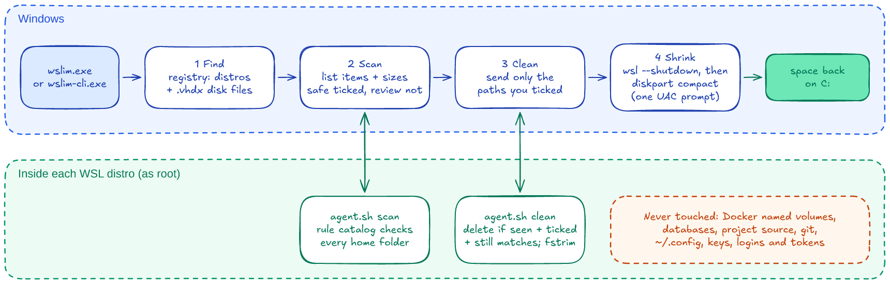
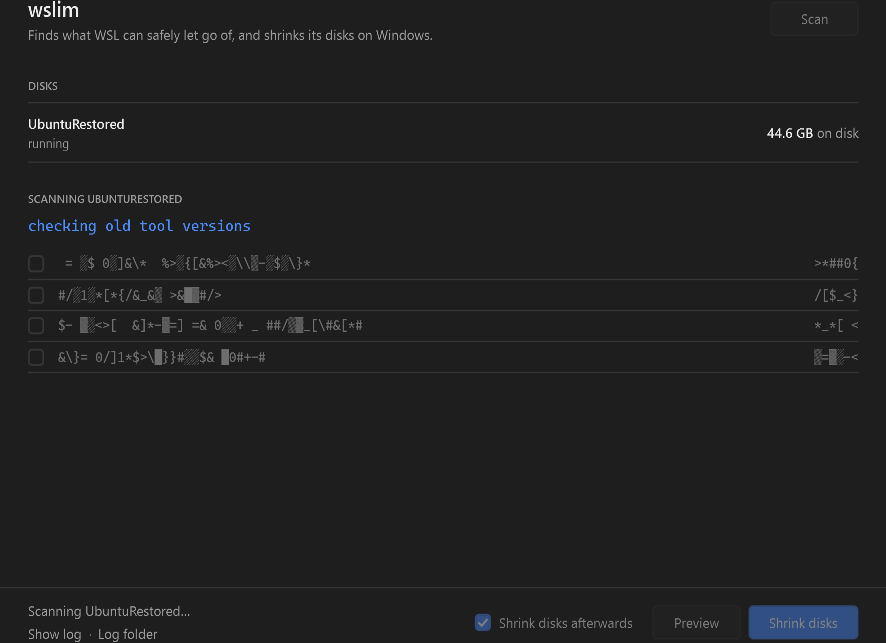
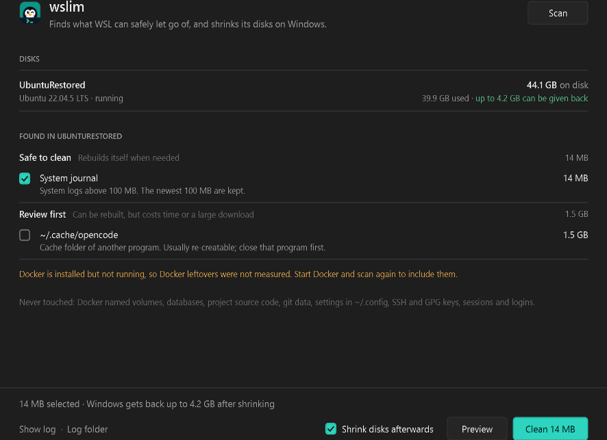

<p align="center"></p>

# wslim

<p align="center">
  <a href="https://github.com/4riful/wslim/releases/latest"></a>
  <a href="https://github.com/4riful/wslim/releases"></a>
  
  
  <a href="LICENSE"></a>
</p>

wslim is a small Windows app that looks inside your WSL distros for space that can safely be given back: package caches, build caches, old tool versions, old logs, Docker leftovers. It shows what it found, cleans what you tick, and then shrinks the WSL `.vhdx` disk files with `diskpart` so the space actually returns to your C: drive. It works with any WSL 2 distro (Ubuntu, Debian, Fedora, Arch, openSUSE, Alpine and others).

## Why it exists

A WSL 2 distro lives in a virtual disk file (`ext4.vhdx`). The file grows as Linux writes data, but it never shrinks
when you delete files inside Linux. After months of `npm install`, `pip install`, Docker builds and editor updates,
the file on C: can be tens of GB larger than what Linux actually stores.

Windows has no reliable automatic fix for this:

- **Windows Home cannot use `Optimize-VHD`.** The usual compaction command belongs to the Hyper-V PowerShell module,
  which exists only on Pro, Enterprise and Education with Hyper-V turned on.
- **WSL does not compact on its own.** Its sparse-disk mode (`sparseVhd`) is experimental, off by default, and was
  disabled for a while after reports of data corruption. A disk switched to sparse can also no longer be compacted.
- **Deleting files is not enough.** Space freed inside Linux stays inside the `.vhdx` until the file is compacted.
- **Not every cache is junk.** Some folders under `~/.cache` hold logins, tokens, local databases or downloaded AI
  models, so "delete all caches" scripts can do real damage.
- **WSL must be off to compact,** which kills running terminals, editors and containers if done without warning.

`diskpart` works on every Windows edition, including Home. wslim uses it, and asks before it stops WSL.

wslim started from exactly that: a developer machine where the WSL disk on C: had grown to **70 GB while Linux used
40 GB**. Getting the space back by hand meant knowing which caches are safe to delete (and which "caches" hold logins,
databases or models), cleaning them, shutting WSL down, and running `diskpart` as administrator. One wrong `rm -rf`
loses data; skipping the `diskpart` step frees nothing on Windows.

wslim does that whole job, with a rule catalog that knows the difference, and shows you everything before it touches
anything. On that first machine it gave back 27 GB.

## How it works



1. **Find**: reads the WSL list from the Windows registry: every distro and its `.vhdx` file. No setup.
2. **Scan**: pipes `src/agent.sh` (the rule catalog) into each distro over stdin, so nothing is installed inside Linux.
   It reports each finding with a tier, a size and the exact paths.
3. **Clean**: sends back the exact paths you ticked. A path is deleted only if it was in the scan, you ticked it,
   and the rule still matches it now. Then `fstrim` tells Windows which blocks are free.
4. **Shrink**: shuts WSL down and runs `diskpart` `compact vdisk` on each disk, after one UAC prompt. This is the step
   that returns space to C:.

The diagram source is [docs/how-it-works.excalidraw](docs/how-it-works.excalidraw).

## How it decides

- **safe**: rebuilds itself on demand (download caches, build caches, old tool versions, old logs). Checked by default.
- **review**: can be rebuilt, but costs time or bandwidth, or you may still want it (Go modules, Maven, AI models, unused Docker images, old `node_modules`). Unchecked by default, with an explanation.
- **never touched**: your data. Docker named volumes, databases, project source, git data, `~/.config`, SSH/GPG keys, sessions and logins.

The full list of rules is in [docs/RULES.md](docs/RULES.md).

<p>
  
  
</p>

## Install

Download from the [latest release](../../releases/latest):

| File | Size | What |
|---|---|---|
| `wslim.exe` | ~120 KB | The app |
| `wslim-cli.exe` | ~60 KB | The same engine without a window, for terminals and scripts |

- Windows 10 or 11 with WSL 2, any edition including Home.
- .NET Framework 4.8 is built into Windows; nothing else to install. No installer.
- No administrator rights, except the shrink step, which asks once through UAC.

## Usage

1. Click **Scan**. wslim scans each distro (starting it if needed) and lists what it can clean, with sizes.
2. Review the list. Safe items are ticked; review items are not. Each item says what it is and how it comes back.
3. Optionally click **Preview** to see the exact commands, without changing anything.
4. Click **Clean**. wslim always asks before it stops WSL, and lists which distros are running. Only the exact folders shown in the scan and ticked are removed; anything that appeared after the scan is left alone. Hover an item to see its paths.

**Shrink disks afterwards** (on by default) runs after cleaning. It shuts WSL down (`wsl --shutdown`), so terminals, VS Code, Claude Code and containers running in WSL will close; save your work first. It then runs `diskpart` (`compact vdisk`) on each disk after one UAC prompt. Disks of Docker Desktop, Rancher Desktop and Podman are only shrunk, never cleaned, and are skipped while Docker Desktop is running. Disks that are sparse files are skipped, because Windows shrinks those itself.

## Command line (no window)

`wslim-cli.exe` uses the same rules, logs and safety checks as the app.

```
wslim-cli scan                          what can be cleaned, per distro
wslim-cli scan --json                   the same, as JSON for scripts
wslim-cli clean --preview               show what a clean of all safe items would do
wslim-cli clean --shrink                clean safe items, stop WSL, shrink the disks
wslim-cli clean --ids npm,gomod         clean exactly these items (review items only this way)
wslim-cli shrink                        only shrink the disks
```

Options: `--distro NAME` limits to one distro, `--yes` skips the confirmation. Without `--yes`, every command that changes
something prints its plan, lists the distros that will be stopped, and asks `[y/N]`. Exit codes: 0 ok, 1 error or
cancelled, 2 usage.

## What it never touches

- Docker named volumes, running or used containers, images in use
- Databases
- Project source code and git data
- `~/.config`, SSH and GPG keys, sessions, logins and tokens (also the ones some tools keep in `~/.cache`)
- Symbolic links, and any path outside the home folders and the known system cache folders; the agent refuses to delete anything else

## Logs

Everything wslim does is written to `%LOCALAPPDATA%\wslim`:

- `logs\wslim-YYYY-MM-DD.log`: every command run in each distro and its output
- `history.tsv`: one line per clean, with the space freed
- `crash.log`: details of unexpected errors

The **Log folder** link in the app opens this folder.

## Build from source

On Windows, run `build.cmd`. It uses the C# compiler that ships with Windows (.NET Framework 4.8), so no SDK is needed. The result is `bin\wslim.exe`.

From inside WSL, run `./build.sh`. It copies the sources to a temp folder on C: and runs `build.cmd` there.

`src/App.cs` must stay C# 5 (the built-in `csc.exe` does not support newer syntax).

## Adding a rule

The cleanup rules live in `src/agent.sh`, a POSIX `sh` script that runs inside each distro. See [docs/RULES.md](docs/RULES.md#how-to-add-a-rule).

## License

MIT. See [LICENSE](LICENSE).
